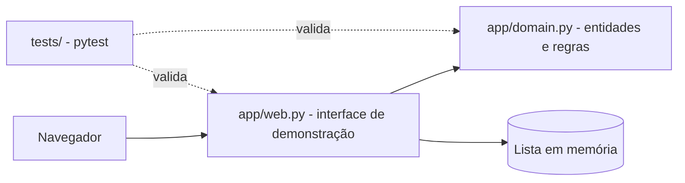
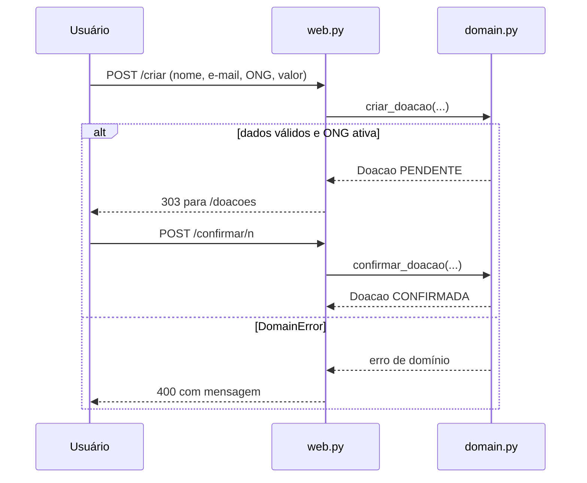

# DOA FÁCIL

Gerenciador de doações que intermedeia doadores individuais e ONGs, reduzindo o desperdício de itens doáveis. Este repositório contém a versão documentada e refinada do projeto DOA FÁCIL para o Bootcamp III (**Entrega 3**), incluindo o núcleo de domínio, a interface web de demonstração, a especificação técnica As-Built, os testes automatizados, o registro de erros lógicos e as decisões arquiteturais.

> Nesta versão o sistema **não movimenta dinheiro real**. A "confirmação" de
> uma doação é apenas uma mudança de estado validada pelo domínio, sem
> integração de pagamento ou banco de dados. Há uma interface web mínima,
> destinada exclusivamente à demonstração local.

## Estrutura do repositório

```
doafacil/
├── app/
│   ├── domain.py              # Entidades e regras de negócio
│   └── web.py                 # Interface web de demonstração (sem framework)
├── tests/
│   ├── test_domain.py         # Testes unitários e casos de borda do domínio
│   └── test_web.py            # Testes da interface web
├── docs/
│   ├── especificacao-sdd.md   # Especificação técnica completa (SDD)
│   ├── ERROS.md               # Registro de erros lógicos
│   └── img/                   # Evidências (prints dos testes)
├── adr/
    ├── ADR-001.md
    ├── ADR-002.md
    ├── ADR-003.md
    ├── ADR-004.md
    └── ADR-005.md      
├── .github/
│   ├── pull_request_template.md  # Template de PR com critérios de aceitação
│   └── workflows/tests.yml    # Pipeline de CI (roda pytest a cada push/PR)
├── .cursorrules               # Diretrizes para agentes de IA
├── Dockerfile                 # Ambiente reproduzível
├── logs_testes_final.txt      # Log dos testes no ambiente padronizado
├── requirements.txt           # Dependências do projeto
└── README.md
```

## Pré-requisitos

- **Python 3.11** ou superior;
- **Git** (caso queira clonar o repositório);
- **pip** (gerenciador de pacotes para instalar as dependências);
- **Docker** (opcional, para execução padronizada em contêiner).

## Como executar localmente

Windows (PowerShell):

```powershell
python -m venv .venv
Set-ExecutionPolicy -Scope Process -ExecutionPolicy RemoteSigned
.venv\Scripts\Activate.ps1
pip install -r requirements.txt
python -m pytest -q
```

O `Set-ExecutionPolicy` vale só para a janela atual do PowerShell e evita o
erro "a execução de scripts foi desabilitada neste sistema" ao ativar o venv.

Linux/macOS:

```bash
python3 -m venv .venv
source .venv/bin/activate
pip install -r requirements.txt
python -m pytest -q
```

Resultado esperado:

```text
20 passed
```

## Interface de demonstração

Para abrir uma tela local com o botão **Confirmar doação**, execute:

```bash
python -m app.web
```

Depois, acesse `http://localhost:8000` no navegador. A página inicial oferece
os botões **Criar doação** e **Ver doações**. A criação recebe nome, e-mail,
ONG e valor; depois, a listagem permite confirmar cada doação. O botão
**Confirmar doação** chama `confirmar_doacao` e altera o estado para
`CONFIRMADA`. Os dados permanecem somente em memória enquanto o servidor está
em execução.

## Como executar com Docker

Com o Docker instalado e em execução, abra o terminal na pasta raiz do projeto e execute:

```bash
docker compose up --build
```

Esse comando levanta a aplicação em `http://localhost:8000` e também executa a suíte de testes em um serviço separado. O processo da aplicação fica ativo no terminal, enquanto o serviço de testes roda e encerra após a execução.

Para rodar apenas os testes, sem subir a aplicação:

```bash
docker compose run --rm tests
```

**Observação:** a execução em contêiner só deve ser apresentada como validada após confirmação de que o comando foi concluído com sucesso no ambiente de execução.

## Agente de IA utilizado

O arquivo [`.cursorrules`](.cursorrules) documenta o contexto funcional do
projeto e as regras seguidas por agentes de auxílio de código (Cursor,
Claude Code ou Codex CLI) durante o desenvolvimento: leitura prévia da
especificação, independência do domínio em relação a frameworks, uso de
`Decimal` para valores monetários, exigência de testes para toda alteração e
obrigatoriedade de revisão humana antes do merge.

## Governança e fluxo de trabalho

- `main`: branch protegida, recebe apenas merges via Pull Request aprovado.
- `develop`: branch de integração das features.
- Branches de trabalho, uma por tarefa, com prefixo pelo tipo:
  `feature/` (funcionalidade), `fix/` (correção), `docs/` (documentação) e
  `chore/` (manutenção).

```bash
git checkout develop
git pull origin develop
git checkout -b feature/nome-da-tarefa
# alterações...
git add <arquivos alterados>
git commit -m "feat: descrição da alteração"
git push -u origin feature/nome-da-tarefa
```

Depois do push, abrir um Pull Request para `develop`, com revisão de outro
integrante antes do merge. Tarefas são organizadas em Issues e em um GitHub
Project.

## Decisões arquiteturais (ADRs)

- [ADR-001](adr/ADR-001.md) — Núcleo de domínio Python independente para o MVP.
- [ADR-002](adr/ADR-002.md) — Interface web mínima sem framework, dados em memória.
- [ADR-003](adr/ADR-003.md) — Dinheiro com `Decimal`, duas casas e valor finito.
- [ADR-004](adr/ADR-004.md) — Estado do servidor em atributo de classe.
- [ADR-005](adr/ADR-005.md) — Critérios de cobertura dos testes automatizados.

## Especificação técnica

A especificação completa (problema, requisitos funcionais e não funcionais,
regras de negócio, contratos de entrada/saída e histórico de refinamentos)
está em [`docs/especificacao-sdd.md`](docs/especificacao-sdd.md).

## Arquitetura

A interface (`app/web.py`) só traduz requisições HTTP em chamadas ao domínio
(`app/domain.py`), que concentra as regras e não depende de framework. A lista
de doações em memória fica na interface (ADR-004); o domínio não guarda estado.



## Fluxo de uma doação



## Qualidade e evidências

- Testes: `python -m pytest -q` (20 testes).
- Cobertura local: `app/domain.py` — 100%; `app/web.py` — 67%; total — 78%. Resultados da execução local, não do Docker.
- Erros lógicos e correções: [`docs/ERROS.md`](docs/ERROS.md).
- Refinamentos da especificação: seção 8 de [`docs/especificacao-sdd.md`](docs/especificacao-sdd.md).
- Decisões: ADR-001 a ADR-005 em [`adr/`](adr/).

## Limitações atuais (escopo futuro)

A interface web disponível é apenas uma demonstração local, em memória e
sem framework. Ainda não foram implementados uma API HTTP para integrações,
banco de dados, autenticação, notificações ou pagamento real. Essas frentes
estão descritas no `Backlog do Produto - DoaFácil` e serão endereçadas em
sprints futuras.

## Variáveis de ambiente

## ⚙️ Variáveis de Ambiente

O projeto **não exige variáveis de ambiente** para sua execução padrão e ambiente de testes.
