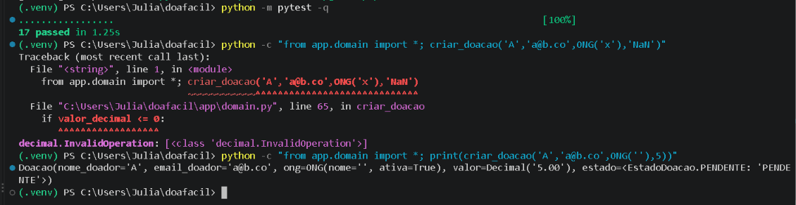
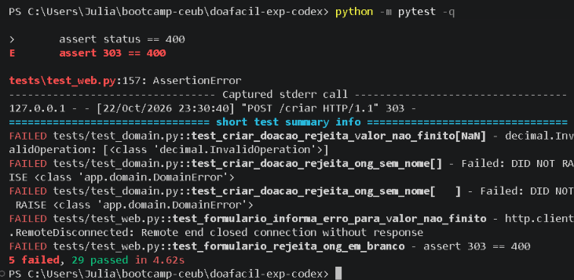
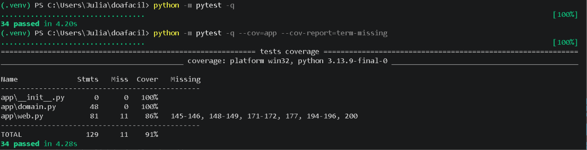

# Registro de Erros Lógicos — DOA FÁCIL

Um erro lógico é o que executa sem falhar na compilação, mas faz a coisa errada.
Cada entrada segue: o quê (título), detecção, causa, classificação (implementação,
especificação ou processo), correção e prevenção. Cada entrada termina com a
**referência cruzada** para a issue, o PR e a linha correspondente da SPEC §8.

**Origem das entradas.** Os erros E-01 a E-04 foram encontrados em uma auditoria
da branch `feature/interface-criacao-landing` (commit `55e65f5`), feita com apoio
de IA (Claude) a partir da leitura do código e de testes exploratórios. Eles
**não** foram detectados pelo harness original (que passava 17/17). Cada correção
de E-01 e E-02 tem teste novo que **falha no código antigo e passa no novo**
(evidência na seção "Prova vermelho → verde"). O E-03 foi encontrado por revisão
de código, e o E-04 pela medição de cobertura. As correções entraram na `develop`
pelo [PR #38](https://github.com/juliabrpereira/doafacil/pull/38) (merge
`c61fc47`). O E-05 foi identificado pela equipe durante a sprint.

## E-01 · Valor `NaN` escapava como exceção não tratada
- Detecção: teste exploratório `criar_doacao(..., valor="NaN")` levantou
  `decimal.InvalidOperation` em vez de `DomainError`. Pela interface,
  `POST /criar` com `valor=NaN` encerrou a conexão sem resposta HTTP.
- Causa: `Decimal("NaN").quantize(...)` não falha, e a falha só ocorre na
  comparação `valor_decimal <= 0` (`app/domain.py`), fora do `try/except`.
- Classificação: implementação **e** especificação. O contrato (SPEC §6.1)
  promete `DomainError` para entrada inválida, mas a SPEC não definia "número
  válido".
- Correção: verificar `is_finite()` dentro do `try` antes de quantizar.
- Prevenção: testes `test_criar_doacao_rejeita_valor_nao_finito` (NaN, sNaN,
  ±Infinity) e `test_formulario_informa_erro_para_valor_nao_finito`.
- Referências: Issue [#26](https://github.com/juliabrpereira/doafacil/issues/26)
  · PR [#38](https://github.com/juliabrpereira/doafacil/pull/38)
  · SPEC §8, linha "RN11 — valor deve ser número finito".

## E-02 · ONG com nome vazio era aceita
- Detecção: `criar_doacao("A", "a@b.co", ONG(""), 5)` retornou doação
  `PENDENTE`; pela interface, `ong="   "` retornou 303 (criada).
- Causa: a SPEC só exigia `ONG.ativa = True` (RN03). Nenhum teste ou regra
  tratava o nome. A implementação seguiu a SPEC ao pé da letra.
- Classificação: **defeito de especificação** (um programador perfeito lendo só
  a SPEC teria produzido o mesmo código).
- Correção: nova regra RN10 na SPEC e validação em `criar_doacao`.
- Prevenção: `test_criar_doacao_rejeita_ong_sem_nome` e
  `test_formulario_rejeita_ong_em_branco`.
- Referências: Issue [#27](https://github.com/juliabrpereira/doafacil/issues/27)
  · PR [#38](https://github.com/juliabrpereira/doafacil/pull/38)
  · SPEC §8, linha "RN10 — ONG precisa ter nome informado".

## E-03 · Fixture de teste configurava atributo inexistente (isolamento falso)
- Detecção: **revisão de código, sem teste cobrindo**. A fixture `servidor_web`
  atribuía `DoaFacilHandler.doacao`, mas o handler usa a lista `doacoes`.
- Causa: o atributo foi renomeado de `doacao` para `doacoes` (commit `55e65f5`)
  e a fixture ficou para trás. A atribuição não falha, só cria um atributo novo.
  A lista `doacoes` (atributo de classe) passou a vazar entre testes: uma
  doação criada num teste continuava existindo no seguinte.
- Classificação: implementação (qualidade do teste).
- Correção: a fixture passou a reiniciar `DoaFacilHandler.doacoes`.
- Prevenção: `test_servidor_comeca_cada_teste_com_apenas_a_doacao_de_demonstracao`.
- Lição: os 17 testes passavam por sorte de ordem, não por isolamento. Este é o
  caso "erro que só a revisão humana pegou" usado no Pilar 4 do relatório.
- Referências: Issue [#28](https://github.com/juliabrpereira/doafacil/issues/28)
  · PR [#38](https://github.com/juliabrpereira/doafacil/pull/38)
  · SPEC: sem linha própria (defeito do teste, não de regra de negócio).

## E-04 · Cobertura real divergia da SPEC (RNF04)
- Detecção: `pytest --cov=app` mostrou 76% no total (`domain.py` 93%,
  `web.py` 67%), contra "100% coberto" na SPEC.
- Causa: ramos sem teste: no domínio, ONG que não é `ONG` e valor não numérico;
  na interface, todo o fluxo `POST /confirmar/<n>` e as rotas 404.
- Classificação: especificação/processo (afirmação não verificada).
- Correção: testes novos; RNF04 reescrito para exigir 100% apenas no núcleo
  (`app/domain.py`), acompanhando a medição de `app/web.py`.
  
- Resultado final (Entrega 3): 20 testes aprovados com 100% de cobertura em
  `app/domain.py` (43 instruções), 67% em `app/web.py` (81 instruções) e
  78% de cobertura total (124 instruções).
- Prevenção: rodar `pytest --cov=app --cov-report=term-missing` e registrar o
  resumo no PR.
- Referências: Issue [#28](https://github.com/juliabrpereira/doafacil/issues/28)
  · PR [#38](https://github.com/juliabrpereira/doafacil/pull/38)
  · SPEC §8, linha "RNF04 — 100% de cobertura apenas para `app/domain.py`".

## E-05 · Evidência de testes fora do ambiente padronizado
- Detecção: os prints das entregas anteriores mostravam divergência entre a execução local e o ambiente padronizado fixado em `requirements.txt` e Dockerfile (Python 3.11).
- Causa: execução em ambiente local sem o ambiente padronizado.
- Classificação: processo.
- Correção: gerar o log final padronizado com `docker run --rm doa-facil` (ver
  `logs_testes_final.txt`). Na execução local da Entrega 3 foram confirmados
  20 testes aprovados e 78% de cobertura total (100% no domínio).
- Prevenção: o template de PR pede o resumo do `pytest` no ambiente padronizado.
- Referências: PR [#41](https://github.com/juliabrpereira/doafacil/pull/41)
  · SPEC: sem linha própria (erro de processo).

## Prova vermelho → verde (E-01 e E-02)
**Verde:** os mesmos testes com a correção do PR #38 e validação final da suíte consolidada da Entrega 3 (20 testes aprovados, 100% de cobertura em `app/domain.py`, 67% em `app/web.py` e 78% no total).

**Detecção:** o harness original passava (17 passed), mas os testes
exploratórios reproduziam E-01 (`NaN` levanta `InvalidOperation`) e E-02
(ONG com nome vazio é aceita).

**Vermelho:** testes novos (commit `abdf3d9`) executados contra o
`app/domain.py` antigo, no worktree da branch `exp/base`.

**Verde:** os mesmos testes com a correção do PR #38, com a cobertura usada
no E-04 (`domain.py` 100%, `web.py` 86%, total 91%).

